# 🚀 Jenkins Demo — Pipeline CI/CD

Application Spring Boot déployée automatiquement via un pipeline Jenkins complet : **Maven → Docker → Kubernetes (K3S)**.


---

## 📖 Description

Ce projet démontre un **pipeline CI/CD complet** :

1. **CI** — Jenkins compile le code Maven à chaque push GitHub
2. **CD** — Jenkins construit l'image Docker et la déploie automatiquement sur K3S

Endpoints :
- `/` → Hello DevOps from Jenkins CI/CD Lab!
- `/health` → OK

---

## 🏗️ Architecture

GitHub → Jenkins → Maven → Docker → K3S → Pods (x2) → NodePort 30090

---

## 🛠️ Stack technique

| Composant | Version |
|-----------|---------|
| Ubuntu Server | 22.04.5 |
| Java | 17 + 21 |
| Maven | 3.6.3 |
| Spring Boot | 3.2.5 |
| Docker | 29.9.0 |
| K3S | v1.35.4 |
| Jenkins | 2.580.1 |

---

## ✅ Prérequis

- Ubuntu 22.04+
- Docker installé
- K3S actif
- Jenkins démarré
- Java 17 et Java 21
- Maven
- Compte GitHub

---

## 📦 Installation

### 1. Cloner le projet

git clone https://github.com/Narjess805/jenkins-demo.git
cd jenkins-demo

### 2. Build manuel

mvn clean package -DskipTests
docker build -t jenkins-demo:1.0.0 .

### 3. Déployer sur K3S

kubectl create namespace jenkins-lab
docker save jenkins-demo:1.0.0 -o /tmp/jenkins-demo.tar
sudo k3s ctr images import /tmp/jenkins-demo.tar
kubectl apply -f deployment.yaml
kubectl apply -f service.yaml

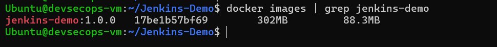

---

## 🔄 Pipeline Jenkins

Job : jenkins-demo-pipeline

| # | Étape | Commande |
|---|-------|----------|
| 1 | Build Maven | mvn clean package -DskipTests |
| 2 | Build Docker | docker build -t jenkins-demo:1.0.0 . |
| 3 | Import K3S | k3s ctr images import |
| 4 | Déploiement | kubectl apply -f deployment.yaml -f service.yaml |
| 5 | Vérification | kubectl rollout status |

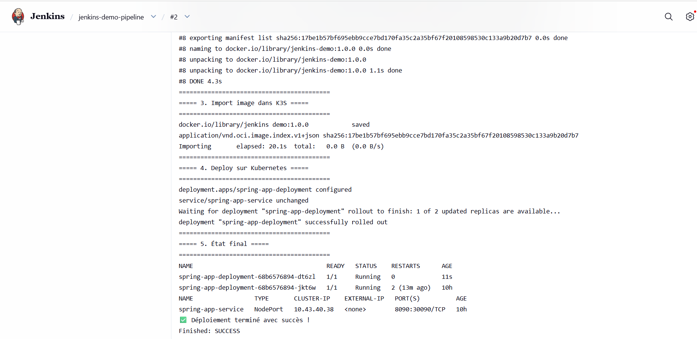

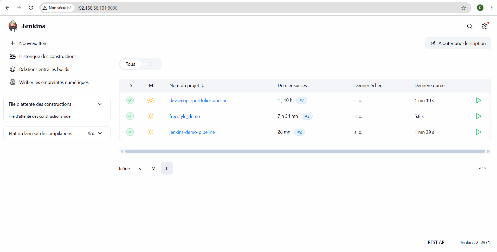

---

## 🧪 Vérifications

### Pods et service

kubectl get pods -n jenkins-lab
kubectl get svc -n jenkins-lab

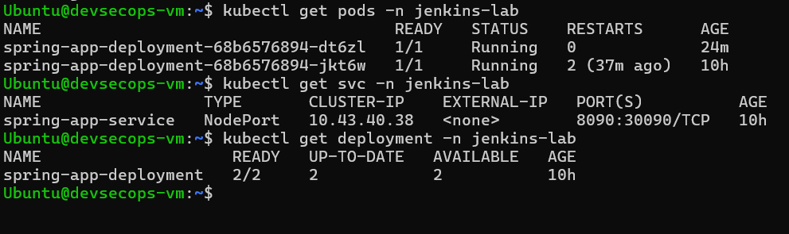

### Test de l'application

curl http://192.168.56.101:30090/
curl http://192.168.56.101:30090/health

Résultat attendu :

Hello DevOps from Jenkins CI/CD Lab!
OK

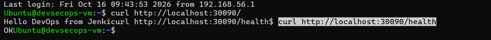

### Interface web

Ouvrir : http://192.168.56.101:30090/

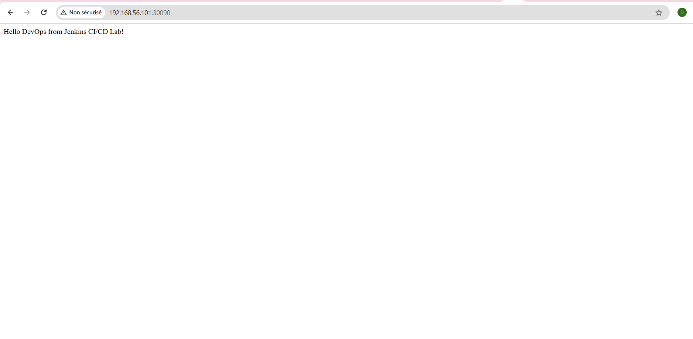

---

## 📁 Structure

jenkins-demo/
├── src/main/java/com/example/demo/
│   ├── DemoApplication.java
│   └── HelloController.java
├── src/main/resources/application.properties
├── Dockerfile
├── deployment.yaml
├── service.yaml
├── pom.xml
└── README.md

---

## 🐛 Problèmes résolus

- Repo original 404 → création d'un projet Spring Boot
- Docker Hub lent → import local via k3s ctr images import
- RAM insuffisante → ajout de 2 Go de swap
- Timeouts Maven → cache copié dans /var/lib/jenkins/.m2/
- Permissions Jenkins → groupe docker + sudoers

---

## 👩💻 Auteur

Narjess Dabbech
📧 narjessdabbech3@gmail.com
🔗 github.com/Narjess805

Lab DevOps / CI-CD.

---

## 📄 Licence

Projet pédagogique — libre d'utilisation.

---

# 🎯 PARTIE 2 — Lab 2 : Jenkins Pipeline (Jenkinsfile)

Cette partie démontre la mise en place d'un **pipeline CI/CD déclaratif** avec un `Jenkinsfile` versionné dans Git (approche moderne).

---

## 📖 Objectifs du Lab 2

- Installer et configurer les plugins Jenkins (Kubernetes CLI, Maven Integration, Docker)
- Configurer les outils globaux (JDK, Maven)
- Créer un `Jenkinsfile` dans le repo GitHub
- Créer un job Pipeline avec **Pipeline script from SCM**
- Automatiser **toutes** les étapes : clone → Maven → Docker → Import K3S → Deploy → Verify

---

## 🔧 Configuration Jenkins (Lab 2)

### Plugins installés

| Plugin | Version |
|--------|---------|
| Kubernetes CLI | 1.375 |
| Kubernetes Client API | 7.3.1 |
| Kubernetes Credentials | 207 |
| Maven Integration | 3.28 |
| Docker | 1336 |
| Docker Commons | 477 |
| Docker API | 3.7.1 |
| + dépendances (jsch, javadoc, cloud-stats, etc.) |

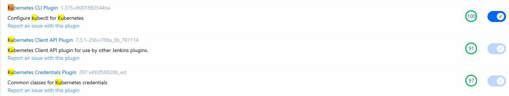

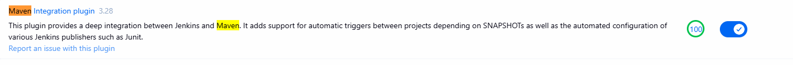

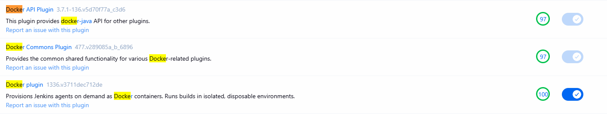

### Outils globaux

**Manage Jenkins** → **Global Tool Configuration** :

| Outil | Nom | Chemin |
|-------|-----|--------|
| JDK | `JDK-17` | `/usr/lib/jvm/java-17-openjdk-amd64` |
| Maven | `maven-3.6.3` | `/usr/share/maven` |

> ⚠️ **Note** : Jenkins tourne sur Java 21 (JRE), le build Maven sur Java 17 (JDK).

---

## 📝 Jenkinsfile

Le fichier `Jenkinsfile` est versionné dans le repo et lu par Jenkins :

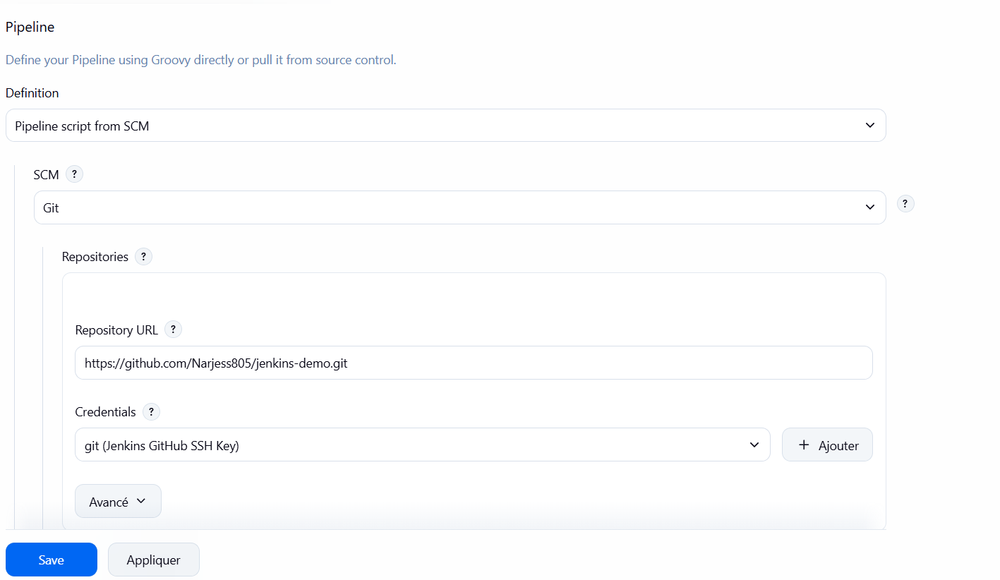

```groovy
pipeline {
    agent any

    tools {
        jdk 'JDK-17'
        maven 'maven-3.6.3'
    }

    environment {
        IMAGE_NAME = "jenkins-demo"
        IMAGE_TAG = "1.0.0-${env.BUILD_NUMBER}"
        K8S_NAMESPACE = "jenkins-lab"
    }

    stages {
        stage('Checkout') {
            steps {
                echo '=== 1. Clone du repo GitHub ==='
                git branch: 'main', url: 'https://github.com/Narjess805/jenkins-demo.git'
            }
        }

        stage('Build Maven') {
            steps {
                echo '=== 2. Build Maven ==='
                sh 'mvn clean package -DskipTests'
            }
        }

        stage('Build Docker') {
            steps {
                echo '=== 3. Build Docker image ==='
                sh 'docker build -t ${IMAGE_NAME}:${IMAGE_TAG} .'
            }
        }

        stage('Import into K3S') {
            steps {
                echo '=== 4. Import de l\'image dans K3S ==='
                sh '''
                    docker save ${IMAGE_NAME}:${IMAGE_TAG} -o /tmp/${IMAGE_NAME}.tar
                    sudo /usr/local/bin/k3s ctr images import /tmp/${IMAGE_NAME}.tar
                '''
            }
        }

        stage('Deploy to K3S') {
            steps {
                echo '=== 5. Déploiement sur K3S ==='
                sh '''
                    sed -i "s|image:.*|image: docker.io/library/${IMAGE_NAME}:${IMAGE_TAG}|" deployment.yaml
                    kubectl apply -f deployment.yaml
                    kubectl apply -f service.yaml
                    kubectl rollout status deployment/spring-app-deployment -n ${K8S_NAMESPACE} --timeout=180s
                '''
            }
        }

        stage('Verify') {
            steps {
                echo '=== 6. Vérification finale ==='
                sh '''
                    kubectl get pods -n ${K8S_NAMESPACE}
                    kubectl get svc -n ${K8S_NAMESPACE}
                '''
            }
        }
    }

    post {
        success {
            echo '✅ Pipeline terminé avec succès !'
        }
        failure {
            echo '❌ Pipeline échoué !'
        }
    }
}


---

## ✅ Résultat du build (Lab 2)

Le pipeline `pipeline-scm-lab2` s'exécute avec succès en 6 étapes :


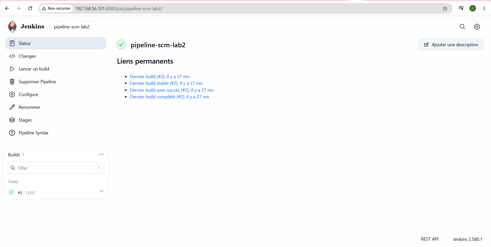

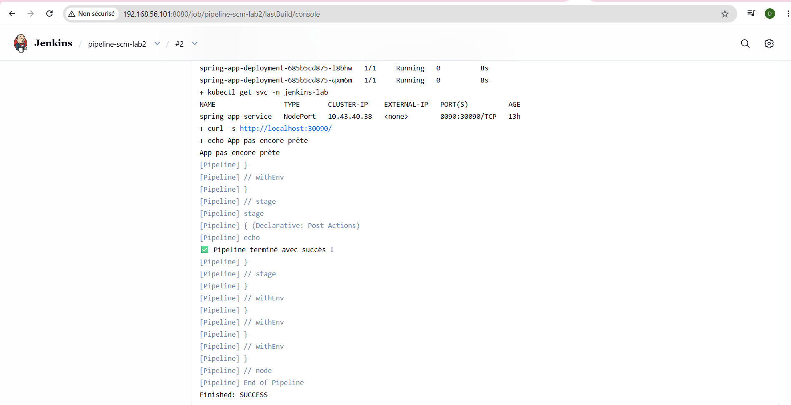

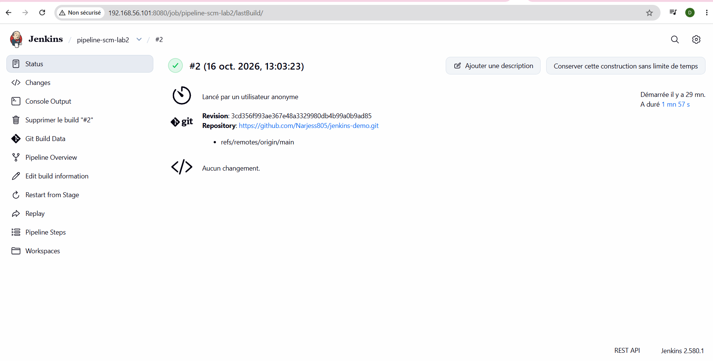

---

## 🔄 Comparaison Lab 1 vs Lab 2

| Aspect | Lab 1 (Freestyle) | Lab 2 (Pipeline) |
|--------|-------------------|------------------|
| Configuration | Interface Jenkins | `Jenkinsfile` versionné |
| Versioning | ❌ | ✅ (dans Git) |
| Reproductibilité | Manuelle | Automatique |
| CI/CD moderne | Legacy | ✅ Standard |
